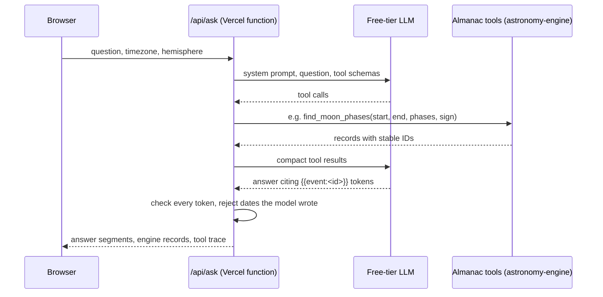

# AstroMoon Calendar

[](https://github.com/bsmithforge/AstroMoon-Calendar/actions/workflows/ci.yml)
[](LICENSE)

**Live at [astromoon.ca](https://astromoon.ca/)**

A Moon phase and zodiac calendar that computes everything in your browser: exact New, Quarter, and Full Moon times, tropical Moon sign ingresses to the second, solar and lunar eclipse peaks, and a daily noon Moon sign snapshot, all shown in the timezone you choose.


## Get it into your calendar

- **Subscribe (recommended).** Open **Subscribe** on the site to add a live `webcal://` feed to Apple Calendar, Google Calendar, Outlook, Fastmail, Proton, Thunderbird, or anything that accepts a calendar URL. It covers a rolling window (1 month back, 12 months ahead) and refreshes on its own, so it never runs out.
- **Download an ICS** for a one-time import of any date range.
- **Print a PDF**: whole-month calendar pages (A4, up to 24 months) or a data table for an exact range.

The feed is served by a small serverless function:

```
GET https://astromoon.ca/api/calendar?tz=America/Edmonton&hemi=northern&phases=1&ingresses=1&daily=0&eclipses=1
```

| Parameter | Values | Default |
| --- | --- | --- |
| `tz` | Any IANA timezone | `UTC` |
| `hemi` | `northern` \| `southern` (Moon illustration orientation) | `northern` |
| `phases`, `ingresses`, `daily`, `eclipses` | `1` \| `0` | `1` |

## Ask the Almanac

Open **Ask** to ask about phases, signs and eclipses in plain words ("When is the next full moon in Scorpio?"). You can also describe an export ("a printable calendar of next year's full and new moons") or search the traditional themes ("planting a garden") on your device. See [How the AI features work](#how-the-ai-features-work).

## How it's calculated

Positions come from [astronomy-engine](https://github.com/cosinekitty/astronomy) (VSOP87 / ELP2000-82), pinned to 2.1.19. The Moon's geocentric apparent ecliptic longitude is mapped onto the tropical zodiac (twelve equal 30° signs from the March equinox); ingress times are refined by bisection to a one-second bracket. The **Methodology** panel on the site compares computed times against published reference values. Traditional sign and phase interpretations are included for interest and are not predictions.

## How the AI features work

The rule throughout: **the AI chooses and words; the astronomy engine supplies every fact.** A language model never states a date or time, and nothing it writes ends up in an exported file.



- **Ask the Almanac** (`server/ai/`, `src/utils/almanacTools.ts`): the model calls six deterministic, validated tools, which find phases, sign changes, eclipses, the Moon on a date, the app's own traditional meanings, and export settings. Its answer cites events as tokens, and the server checks every token against what the tools returned. If the model writes a date itself, it gets one correction, and after that the answer becomes a plain list of the results. The browser shows each event's date and time from the engine's records. "How this was answered" lists every lookup.
- **Describe your export:** `prepare_export` turns a request into export settings, never a file. They're validated with the same limits as the export dialog, which opens prefilled for review. A test checks that a draft and the same settings entered by hand produce identical ICS bytes.
- **Theme search** (`src/utils/themeSearch.ts`): runs entirely in the browser. A small open-source embedding model (all-MiniLM-L6-v2, about 29 MB, downloaded once on the first search) runs in a Web Worker and matches your words against the app's own sign and phase copy. It then lists the coming days with that sign or phase. Nothing you type is sent anywhere.
- **Providers and cost:** the endpoint speaks the OpenAI-compatible Chat Completions format through plain `fetch`, so the provider is configuration. It runs on free tiers with no billing attached: Groq (`gpt-oss-120b`) is primary, and Google Gemini (`3.5-flash-lite`) is the fallback outside the EEA, UK and Switzerland, as Gemini's free-tier terms require. When the quota runs out, Ask says the almanac is resting and offers theme search.
- **Evidence:**
  - a 20-question live eval: both providers passed grounding on 20/20 answers
  - a 16-query theme eval: 16/16
  - 77 unit tests that run in CI against scripted models, without a key

  Details: [docs/ai-evals.md](docs/ai-evals.md). The phased plan and its decision log: [docs/ai-features-plan.md](docs/ai-features-plan.md).

## Development

```
npm ci
npm run dev      # Vite on http://localhost:3000, also serves /api/calendar and /api/ask
npm test         # node test runner: ICS, feed, runtime emulation, almanac tools, Ask, exports, theme search
npm run lint     # tsc --noEmit
npm run build    # static build to dist/, plus the bundled API functions
```

Stack: React 19, TypeScript, Vite 6, Tailwind CSS 4, jsPDF. No database and no auth. API keys are only needed for Ask: copy `.env.example` to `.env.local` and add free-tier keys to try it locally. See [AGENTS.md](AGENTS.md) for the code map, domain rules, and conventions, and [CONTRIBUTING.md](CONTRIBUTING.md) if you'd like to send a change.

## Run your own

Fork it and import the fork into [Vercel](https://vercel.com/new) with the Vite preset. No environment variables are required; pushes to `main` deploy. To turn on Ask, add the `AI_*` variables from `.env.example` in Vercel (free-tier keys, no billing), and add a WAF rate-limit rule on `/api/ask`. Without them, Ask says it isn't available and everything else works. The feed handler in `server/calendar.ts` is bundled by esbuild during `npm run build` and exposed through `api/calendar.js`, and `vercel.json` sets caching headers. The subscription URL is built from the page origin, so the feed works on whatever domain you deploy to.

Things you'll want to change for your own deployment:

- `index.html`: `<title>`, canonical URL, Open Graph / Twitter URLs, and the JSON-LD block
- `public/robots.txt` and `public/sitemap.xml`: site URL
- `public/og-image.jpg`, `public/masthead_banner.jpg`, `public/moon_engraving.jpg`: artwork
- `src/App.tsx`: the "Made by" footer link
- `src/utils/icsExport.ts` and `src/utils/subscription.ts`: calendar name and `PRODID`

Any static host works for the app itself. Only the live feed and Ask need serverless functions; ICS download, PDF export and theme search run entirely in the browser.

## License

[MIT](LICENSE). Astronomical calculations use [astronomy-engine](https://github.com/cosinekitty/astronomy) (MIT). Sign and phase interpretations are traditional and offered for interest only.

Made by [Brody Smith](https://smiths-forge.ca/).
