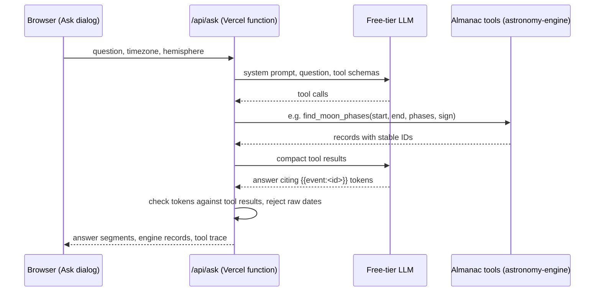
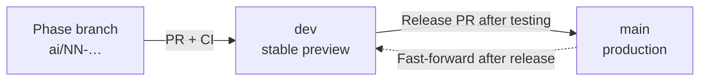

# AI features plan

**Status:** Proposed, October 2026. This plan is updated as each phase lands. The decision log at the end records what changed and why.

## Summary

This plan adds three AI features. Each one builds on AstroMoon's deterministic astronomy engine rather than replacing it.

1. **Ask the Almanac.** People ask questions in plain language, such as "When is the next full Moon in Scorpio?" A free-tier language model answers by calling the app's own astronomy functions as tools. The model never writes a date or time. It refers to events by ID, and the app displays the times the engine computed.
2. **Describe your export.** A sentence like "full Moons and eclipses for 2027, Edmonton time, as a PDF" is turned into a validated export configuration. That configuration opens the existing Export dialog with the fields filled in. The user reviews it and downloads. The AI never generates file contents.
3. **Theme search.** People search the traditional interpretations by meaning, for example "days for new beginnings." A small embedding model runs in the browser, so this needs no server and no key, and it still works when the AI quota is used up.

## Goals and constraints

- **No added cost.** The plan uses a free-tier LLM provider with no payment method on file, Vercel Hobby, and no new services or databases. If the free quota runs out, the feature says so and the rest of the app is unaffected.
- **Accuracy stays deterministic.** Every date, time, sign and eclipse detail comes from astronomy-engine through the existing utilities in `src/utils/astronomy.ts`. The model only decides what to look up and how to word the answer.
- **Exports stay AI-free.** The contents of ICS and PDF files don't change. The export builder only fills in the existing form.
- **Mobile is first-class.** Every feature works on phones from 320 px up. Downloading the on-device model is opt-in.
- **The app works without a key.** `npm run dev`, CI and forks need no API key. When no key is configured, Ask shows an "unavailable" state.
- **The work is visible.** Each phase is a PR made of small, reviewable commits, with tests and a description of how it was verified. Prompts, tool schemas and eval results are committed to the repo.

**Not in v1:** multi-turn chat memory, accounts or saved history, AI-written horoscopes, AI text inside exported files, and a self-hosted model.

## Architecture

### Key decisions

- **Tools run on the server and reuse the feed's bundling pattern.** `server/ask.ts` imports the same `src/utils` helpers that the subscription feed already bundles. `scripts/build-api.mjs` gains a second entry, and `api/ask.js` re-exports the result, just as `api/calendar.js` does now. The server needs no new dependencies.
- **The provider adapter is provider-neutral.** A single `fetch` client speaks the OpenAI-compatible Chat Completions format. Groq, Google Gemini, Cloudflare Workers AI and OpenRouter all offer that format. The provider and model are set by environment variables, so switching providers, or falling back when one quota runs out, is a configuration change rather than a code change. No SDK dependency is added.
- **Answers are grounded by design.** Tool results carry the record IDs the engine already produces (`quarter-…`, `ingress-…`, `eclipse-…`, the same IDs behind ICS UIDs). The model has to write `{{event:<id>}}` instead of a date. The server rejects an answer that cites an ID no tool returned, or that contains a raw date or time. It retries once with a correction, and if that fails it falls back to a templated list of the tool results.
- **Each answer shows how it was produced.** Every answer includes a tool trace, for example "Searched Full Moons, Oct 2026 – Oct 2027, America/Edmonton", shown under "How this was answered."
- **Theme search runs only in the client.** Transformers.js and the embedding model load through a dynamic import on first use, the same way jsPDF loads today.

### Abuse and quota protection

1. **Vercel WAF rate-limit rule** on `/api/ask`. Hobby allows one fixed-window rate-limit rule per project.
2. **Limits in the handler:**
   - questions of at most 400 characters
   - POST with JSON only
   - at most 4 tool rounds and a bounded `max_tokens`
   - a 20-second timeout on provider calls
   - tool ranges of at most 3,660 days, within 1900–2100
   - at most 40 records per tool result
3. **No billing account on the provider.** When the free tier runs out, the provider returns a 429. The UI shows "The almanac is resting" and offers theme search instead.

Hobby doesn't bill for overages. Going over its usage limits can pause the project, though, which would take the whole calendar offline, so layers 1 and 2 protect the site as well as the quota. Confirm the current Hobby limits during Phase 3.

### Privacy

- **Ask:** questions go to the configured provider, and the Ask dialog says which one. Some free tiers may use prompts to improve their products, so the provider comparison records each candidate's terms.
- **No personal data:** the app doesn't request or store any.
- **Theme search:** sends nothing anywhere. The model files are downloaded once from Hugging Face's CDN and then cached by the browser.

## Workflow

Changes move through three levels. Phase branches merge into `dev`, and `dev` is released to `main`. `main` is production. `dev` is the integration branch, where merged phases are tested together on a stable Vercel preview before they reach users.

### One-time setup

- **Sync `dev`:** fast-forward `dev` to `main` before the first phase merges. It is currently two commits behind, with no commits of its own.
- **Branch protection:** protect `main` and `dev` on GitHub so changes arrive only through PRs with passing CI.
- **Preview key:** in Vercel, scope the AI provider variables to the Preview environment for the `dev` branch only. Where the provider allows it, use a separate key or project from production, so testing doesn't use up production quota. Phase-branch previews then run without a key, which tests the "unavailable" state.
- **Deployment Protection:** if Vercel's Deployment Protection is on for previews, sign in to Vercel on the test phones. Calendar apps can't fetch a protected feed URL, so test webcal subscriptions on production.

### Phase branches

- **Branches:** one per phase, cut from `dev` (`ai/00-plan`, `ai/01-groundwork`, and so on). Each opens a PR into `dev`.
- **Commits:** several small commits per PR. Each passes `npm run lint`, `npm test` and `npm run build`.
- **Merging:** use **merge commits**, not squash, at both levels, so the individual commits stay visible in `main`'s history.
- **PR descriptions:** what changed, why, how it was verified (commands, devices, and screenshots for UI changes), and any known gaps. UI PRs link to their branch preview.
- **Merge order:** phases merge into `dev` in order.

### Testing on `dev`

After a phase merges, repeat its **Verify** checklist on the `dev` preview. There it runs alongside everything merged before it, and with a live key from Phase 3 on. Real-device checks happen here, including iOS Safari, Android Chrome, and downloading and opening exported files.

### Releasing to `main`

- **Release PR:** open a PR from `dev` into `main` that lists the phase PRs it includes and the results of the `dev` testing.
- **After merging:** fast-forward `dev` to `main`, so both branches start the next phase from the same commit.
- **Fixes:** problems found while testing on `dev` are fixed on a new branch into `dev`, not straight into `main`. Urgent production fixes branch from `main` and merge into `main`, and then `main` is merged back into `dev`.

| Release | Phases | Notes |
| --- | --- | --- |
| 1 | 0–3 | Plan, groundwork, tools and endpoint. Nothing user-visible ships. With no production key, `/api/ask` returns 503 and nothing links to it. |
| 2 | 4 | Ask UI. Set the production key and the WAF rule before merging. |
| 3 | 5 | Export builder. Run the full export checklist on real devices against `dev` first. |
| 4 | 6 | Theme search. |
| 5 | 7 | Docs and the final production pass. |

### Secrets

Keys live only in Vercel environment variables and a local `.env.local` (already covered by `.env*` in `.gitignore`). Never prefix them with `VITE_`, because Vite would inline them into the client bundle.

## Phases

### Phase 0: Plan and workflow (`ai/00-plan`)

1. `Add AI features plan`: this document.
2. `Run CI on pushes to dev`: add `dev` to the `push` branches in `.github/workflows/ci.yml`. PRs into `dev` already run CI, because the workflow runs on every pull request. This adds a run for the merged result on `dev`.

### Phase 1: Groundwork with no behavior change (`ai/01-groundwork`)

These are refactors that later phases depend on. They land separately so the review only has to confirm nothing changed.

1. `Extract export date-range validation into a shared util`. Move the date check, the ordering check, the month count, and the 24-month and 3,660-day limits from `ExportModal` into `src/utils/dateRange.ts` as named constants and functions. `ExportModal` behaves exactly as before.
2. `Test date-range validation`. Add `tests/dateRange.test.ts` covering leap days, impossible dates (`2026-02-30`), reversed ranges, and the exact 24-month and 3,660-day boundaries.
3. `Export Moon phase meanings as data`. Move the eight phase meanings out of `getMoonPhaseInfo()` into an exported constant, which the theme-search corpus needs. Output is unchanged.
4. `Bundle multiple API entries`. `scripts/build-api.mjs` builds a list of entries into `server/dist/[name].js`, and `tests/apiRuntime.test.ts` runs every entry.
5. `Add pull request template`. Add `.github/pull_request_template.md` with sections for what, why, verification and gaps.

**Verify:** lint, test and build. In the export dialog, try custom dates, half-edited date fields, and both range limits.

### Phase 2: Deterministic almanac tools, no AI yet (`ai/02-almanac-tools`)

This builds and tests the tools the model will call before any model is involved.

1. `Add almanac tool definitions`. Add `src/utils/almanacTools.ts` with a JSON schema and an implementation for each tool:
   - `find_moon_phases({ start, end, phases?, sign? })`, which uses `getQuartersInRange()`
   - `find_sign_ingresses({ start, end, sign? })`, which uses `findIngressesInRange()`
   - `find_eclipses({ start, end, type?, kind? })`, which uses `getEclipsesInRange()`
   - `get_moon_on_date({ date })`, which takes the noon snapshot from `generateRangeDataset(date, date, …)`

   **Validation:** every argument is checked before any search runs. Dates go through `dateRange.ts`, signs are matched against `ZODIAC_SIGNS`, and timezones are checked with `isValidTimeZone()`.

   **Defaults:** timezone and hemisphere default to the user's settings. "Today" is computed in the selected timezone with `getLocalDateComponents()`. The current time (`now`) can be injected for tests and evals.

   **Results:** sorted chronologically and capped.
2. `Add compact tool result formats`. Add a lean format for the model (ID, type, local date and time, sign, kind) and a fuller one for the UI, with ISO strings in place of `Date` objects.
3. `Test almanac tools`. Add `tests/almanacTools.test.ts` covering:
   - fixed-date queries checked against the existing helpers' output
   - the Pisces-to-Aries ingress wraparound
   - Auckland date rollover and Kolkata's half-hour offset
   - quarter and eclipse peaks staying separate records
   - invalid arguments rejected without running a search
   - result caps

**Verify:** lint, test and build.

### Phase 3: Ask endpoint (`ai/03-ask-endpoint`)

1. `Add OpenAI-compatible chat client`. Add `server/ai/provider.ts`, a `fetch`-based client configured by `AI_BASE_URL`, `AI_MODEL`, `AI_API_KEY` and optional `AI_FALLBACK_*` variables. It applies a timeout and maps 429 and 5xx responses to typed errors.
2. `Add Ask system prompt`. Add `server/ai/prompt.ts`, committed with comments. It covers:
   - scope: the Moon, the zodiac, eclipses and this app
   - the rule that events are cited as tokens, never written as dates
   - labeling astrology as traditional interpretation
   - declining off-topic requests briefly
3. `Add tool loop and grounding guard`. Add `server/ai/ask.ts`, which:
   - runs up to 4 tool rounds
   - checks that every cited token matches a record a tool returned
   - detects raw dates and times in the answer, retries once with a correction, then falls back to a template

   It returns `{ segments, events, trace, model }`.
4. `Add /api/ask handler`. Add `server/ask.ts`, which:
   - accepts POST with JSON only, within size limits, and sends `Cache-Control: no-store`
   - returns 503 `not_configured` when no key is set
   - returns 503 `resting` with `Retry-After` when the quota is used up

   This commit also adds:
   - the `api/ask.js` entry
   - a Vite dev route that reads `.env.local` on the server
   - `.env.example`, plus a `!.env.example` exception in `.gitignore`
5. `Test the ask loop with a scripted fake model`. These are deterministic tests that run in CI, covering:
   - multi-round tool calls and bad tool arguments
   - invented IDs and answers containing raw dates
   - the retry followed by the fallback
   - quota and timeout errors, oversized input and the wrong HTTP method

   The runtime test also covers the bundled `api/ask.js`.
6. `Add live eval script and question set`. Add `evals/ask-questions.json` with 20–30 questions anchored to a fixed date. Each question lists the tools and arguments it expects, plus the record IDs the engine produces for it. `scripts/eval-ask.mjs` runs the set by hand with a key and never runs in CI. It reports how often the right tool was chosen, grounding failures and latency.
7. `Record provider comparison`. Run the eval against 2–3 free providers. Commit `docs/ai-evals.md` with the results, the limits observed and each provider's data-use terms. Choose a primary and a fallback, and update the decision log.

**Verify:** lint, test and build; `curl` against the local dev server; after merging, the `dev` preview with its branch-scoped key.

### Phase 4: Ask UI (`ai/04-ask-ui`)

1. `Add ask client and response types`. Add `src/utils/askClient.ts`.
2. `Add Ask dialog`. Add `src/components/AskModal.tsx`:
   - same focus trap, Escape handling and scroll lock as the existing modals
   - example questions, and answers rendered from segments
   - event chips showing engine-computed times with a timezone label
   - a "How this was answered" disclosure and a note about AI and privacy
   - states for loading, unavailable, resting and error
3. `Open days from answers`. Tapping a chip moves the calendar to that month and opens `DayDetailModal` for the date, using the app's timezone.
4. `Add Ask to the header`. Add a new action that collapses to a 44 px icon-only button below `sm`, like Share, Subscribe and Export. Check that the header still fits at 320 px.
5. `Mobile pass for Ask`:
   - the input stays reachable with the on-screen keyboard open (`dvh` units or the visual viewport API)
   - safe-area insets and landscape
   - long answers scroll inside the dialog

**Verify:**
- widths of 320, 375/390 and 430 px, a tablet and desktop, in portrait and landscape
- keyboard-only use
- real iOS Safari and Android Chrome devices
- locally with `.env.local`, on the phase-branch preview (no key), and on the `dev` preview (live key)

### Phase 5: Describe your export (`ai/05-export-builder`)

1. `Add prepare_export tool`. This tool:
   - validates through `dateRange.ts`, applying the limit for the chosen format: 24 whole months for calendar PDF, 3,660 days for ICS or table PDF
   - requires at least one event type for ICS and table output
   - returns an `ExportDraft` with dates, timezone, hemisphere, toggles and format, and never a file
2. `Prefill the export dialog from a draft`. Add an optional `draft` prop on `ExportModal`:
   - the dialog's initial state comes from the draft, under a banner reading "Prefilled from your request. Review before downloading."
   - the recommended download button is emphasized but still needs a tap, which also keeps iOS's requirement that a download start from a user gesture
   - closing the dialog clears the draft, so reopening it from the header starts from app state as it does now
   - the main calendar's filters don't change
3. `Offer "Review export" in Ask answers`.
4. `Test export drafts`. Cover draft validation and the mapping from draft to dialog settings. A draft must produce the same records as the same settings entered by hand.

**Verify:** follow the export checklist in `AGENTS.md`:
- produce ICS and both PDF modes from a draft and by hand, on desktop and phones, and open the files
- check reopen behavior
- confirm a timezone override is shown in the dialog

### Phase 6: On-device theme search (`ai/06-theme-search`)

1. `Add theme corpus`. Add `src/utils/themeCorpus.ts`, with entries taken from `ZODIAC_SIGNS` (theme, description, activities) and the phase meanings. Each entry points to a sign or a phase.
2. `Add on-device embedding search`. Pin an exact `@huggingface/transformers` version and load it with a dynamic import. Use quantized `all-MiniLM-L6-v2` (about 23 MB). The corpus is embedded on first use and results are ranked by cosine similarity. Below a minimum similarity, the result is "no strong match."
3. `Add theme search UI`. This is a tab in the Ask dialog:
   - an explicit "Download on-device model (≈23 MB)" step with progress
   - results that show the matching theme text and the next days whose noon sign or phase matches, within a 90-day window
   - tapping a result opens that day
   - the tab is offered automatically when Ask is unavailable or resting
4. `Test ranking and corpus`. Unit tests use fixed vectors, so CI never downloads the model. A manual eval script checks that sample queries return the expected entries in the top three, and its results go in `docs/ai-evals.md`.

**Verify:**
- the main bundle chunk is unchanged (compare build output sizes before and after)
- first-load time and memory on a mid-range phone
- works offline after the first load
- the WASM backend runs on iOS Safari

### Phase 7: Docs and launch (`ai/07-launch`)

1. `Document AI architecture`. Add a "How the AI features work" section to the README, with the diagram and links to this plan and the eval results. Update `AGENTS.md`: the code map, the environment variables, and these rules:
   - the model never writes timestamps
   - exports stay free of AI text
   - keys are never `VITE_`-prefixed

   Update `CONTRIBUTING.md`, which should still say no key is needed.
2. `Update methodology and static content`. Add a section on AI answers to the methodology modal, and update the static content and SEO metadata in `index.html`.
3. **Final production pass (not a commit):** the production key and WAF rule go in before Release 2. At this point, confirm that:
   - the provider accounts still have no billing attached
   - the WAF rule is active
   - every feature works on production, on real devices

## Risks

| Risk | Mitigation |
| --- | --- |
| A free tier changes or ends | Provider-neutral adapter and a fallback provider. Ask turns itself off cleanly, and theme search keeps working. |
| Abuse uses up the quota or Vercel limits | WAF rule, handler limits, and no billing on the provider. |
| The model states something wrong | Dates appear only as tokens, cited IDs are checked, raw dates are rejected, a templated fallback exists, and the eval set measures accuracy. |
| Prompt injection | The tools are read-only, and the only thing a request can produce besides an answer is an export draft the user has to confirm. No secrets are in the prompt and nothing is stored. |
| Bundle size or memory grows on phones | Dynamic imports, opt-in model download, the WASM backend, and bounded date windows. |
| A free tier uses prompts for training | Recorded in the provider comparison and disclosed in the Ask dialog. |

## Decision log

| Date | Decision | Reason |
| --- | --- | --- |
| 2026-10-27 | The model cites events by ID token and never writes timestamps. | Accuracy stays with the deterministic engine, and every answer can be checked. |
| 2026-10-27 | Use an OpenAI-compatible `fetch` adapter with no SDK. | Lets the app switch providers or fall back between them, without a new dependency. |
| 2026-10-27 | v1 handles single questions, not multi-turn chat. | Saves free quota and keeps requests stateless. |
| 2026-10-27 | Embed the theme corpus in the browser, not at build time. | Avoids committing generated vectors or downloading the model in CI. Revisit if it takes more than 3 s on a mid-range phone. |
| 2026-10-27 | Phase branches merge into `dev`, and `dev` reaches `main` through release PRs. | Merged phases are tested together on a stable preview, with a live key and on real devices, before production. |
| Pending | Choice of primary and fallback provider | To be decided by the Phase 3 provider comparison. |
